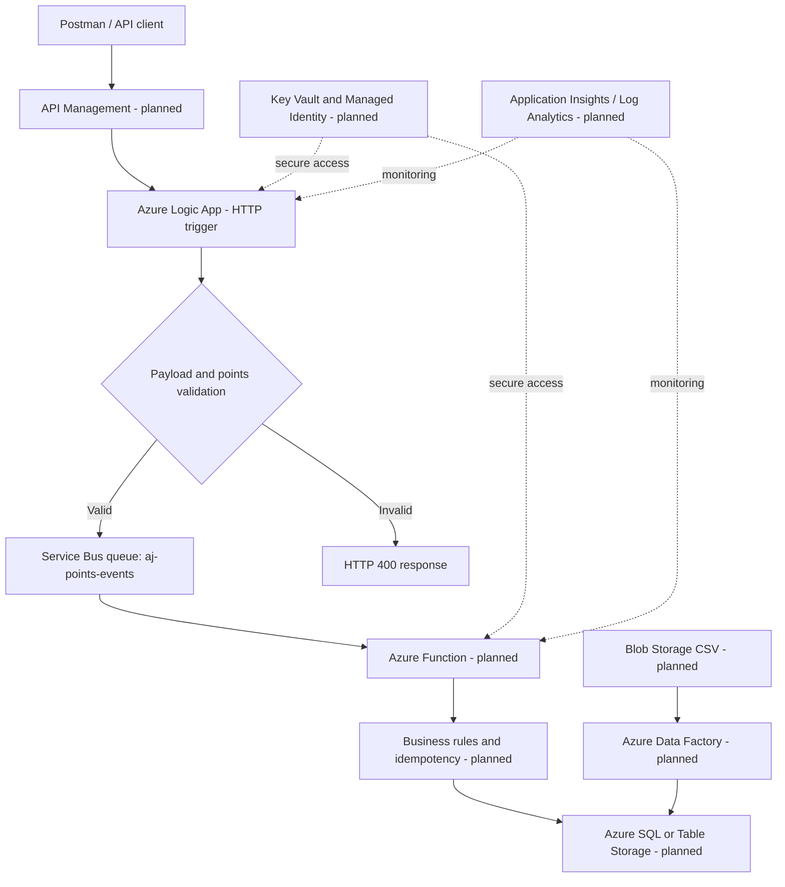

# SkyPoints – AJ Airlines Azure Integration Pipeline

**A hands-on Azure integration learning project by Ajay K Yadav**

SkyPoints is a personal learning project based on a fictional airline loyalty platform, **AJ Airlines**. The goal is to build and document an event-driven integration pipeline using Azure integration services.

> **Project status (11 November 2026): In progress.** The Logic App HTTP-triggered workflow, JSON validation, points condition, and HTTP responses have been configured and tested. A Service Bus namespace and queue have been created. The Logic App-to-Service Bus message delivery is **not yet verified**. APIM deployment was blocked by the training sandbox's Azure Policy restrictions. No production system or real passenger data is involved.

## Objectives

- Accept loyalty-points events over HTTP.
- Validate incoming JSON and apply basic business rules.
- Publish accepted events to Azure Service Bus.
- Process messages asynchronously with Azure Functions.
- Store transactions and prevent duplicate processing.
- Secure service-to-service access with managed identity and Key Vault.
- Monitor the solution using Application Insights, Azure Monitor, and KQL.
- Add a batch ingestion path with Azure Data Factory.
- Eventually define infrastructure with Bicep and add CI/CD.

## Target architecture



The diagram represents the **target design**, not a claim that every component is already deployed.

## Technology scope

| Technology | Planned use | Current state |
|---|---|---|
| Azure Logic Apps | HTTP intake, validation, orchestration | Initial workflow configured and tested |
| Azure API Management | API gateway, policies, throttling | Not deployed; sandbox policy blocked deployment |
| Azure Service Bus | Reliable queue-based decoupling | Namespace and queue created; message delivery verification pending |
| Azure Functions (C#) | Queue-triggered processing | Not started |
| Azure SQL / Table Storage | Transaction persistence | Not started |
| Key Vault | Secret storage | Not started |
| Managed Identity | Passwordless service authentication | Not started |
| Application Insights / Log Analytics | Telemetry and KQL | Not started |
| Azure Data Factory | Scheduled CSV batch ingestion | Not started |
| Bicep / CI/CD | Repeatable infrastructure and deployment | Optional / not started |

## Repository structure

```text
skypoints-azure-integration/
├── README.md
├── .gitignore
├── LICENSE
├── SECURITY.md
├── apim/
│   └── README.md
├── adf/
│   └── README.md
├── function-app/
│   └── README.md
├── infra/
│   └── README.md
├── logic-app/
│   └── README.md
├── postman/
│   ├── AJ-Airlines-SkyPoints.postman_collection.json
│   └── environments/
│       └── local-sandbox.postman_environment.json
├── queries/
│   └── README.md
├── sample-data/
│   ├── valid-points-event.json
│   └── invalid-points-event.json
├── scripts/
│   └── README.md
└── docs/
    ├── architecture.mmd
    └── project-status.md
```

Folders that are not implemented yet contain a README explaining their intended purpose. Add exported Azure workflow/configuration files as they are built, after removing secrets and tenant-specific identifiers.

## Sample event

See [`sample-data/valid-points-event.json`](sample-data/valid-points-event.json).

Example event:

```json
{
  "eventId": "AJ-EVT-10001",
  "passengerId": "AJ-PAX-1001",
  "airline": "AJ Airlines",
  "flightNumber": "AJ302",
  "origin": "DEL",
  "destination": "LHR",
  "points": 1500,
  "eventType": "POINTS_CREDIT",
  "eventDate": "2026-11-11T10:30:00Z"
}
```

All names and data are fictional.

## Current implementation notes

- The Logic App HTTP trigger and validation flow were exercised with valid and invalid points values.
- The positive-points path returned HTTP 202 in testing.
- The Service Bus namespace and `aj-points-events` queue were created in a temporary KodeKloud Azure sandbox.
- A direct HTTP-to-Service-Bus REST approach was attempted after the managed connector connection was blocked by Azure Policy. Queue metrics showed zero incoming messages at the time the sandbox expired. Therefore, successful message delivery is **not claimed**.
- APIM creation was blocked by sandbox policy restrictions.
- Sandbox resources and credentials are temporary and may no longer exist after the session expires.

## Run / test

1. Import `postman/AJ-Airlines-SkyPoints.postman_collection.json` into Postman.
2. Set the `logicAppTriggerUrl` collection variable to the HTTP POST URL generated by your Logic App.
3. Send the **Valid points event** request. The expected response for the currently implemented positive-points path is HTTP 202.
4. Send the **Invalid points event** request. The workflow should follow the invalid branch and return the configured client error response (currently intended as HTTP 400).
5. Check Logic App Run history for the trigger, condition, and response action.
6. Once Service Bus publishing is verified, check the queue with Service Bus Explorer.

Do not publish a real Logic App trigger URL if it contains a SAS signature or other access token. Use placeholders in this repository.

## Security

**Never commit:**
- Azure usernames or passwords.
- Client secrets, certificates, or private keys.
- Service Bus primary/secondary keys or connection strings.
- Generated SAS tokens.
- Logic App callback URLs containing `sig=` or other credentials.
- Subscription IDs, tenant-specific exports, or environment files containing secrets unless sanitized.

Use placeholders in examples. Rotate any credential that has been exposed. See [`SECURITY.md`](SECURITY.md).

## Learning and delivery plan

1. Verify Logic App → Service Bus message delivery.
2. Build a Service Bus-triggered Azure Function in C#.
3. Persist processed events and implement idempotency using `eventId`.
4. Add Key Vault and managed identity.
5. Add Application Insights, Log Analytics, KQL queries, and alerts.
6. Build an ADF CSV ingestion pipeline.
7. Add Bicep and CI/CD if sandbox access permits.
8. Record a short demo and update this README with verified evidence.

## Disclaimer

This repository documents a personal learning project using fictional AJ Airlines data. It is not affiliated with any real airline and is not a production-ready system.
